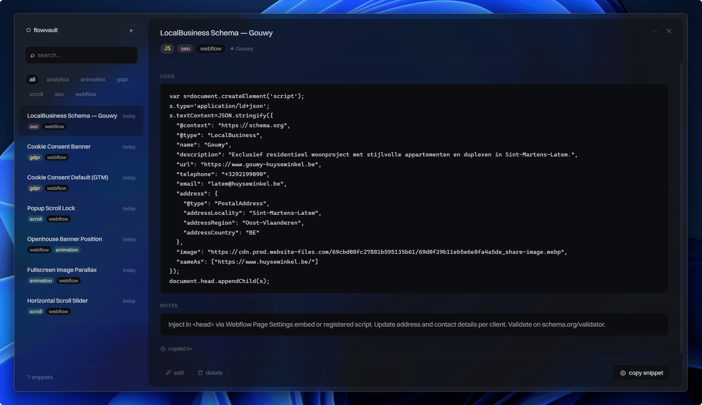

# Graphene

A minimal desktop app for writing markdown notes and keeping reusable code snippets as code blocks inside them — built with Tauri v2, React 19, and TypeScript.



## Features

### Notes
- One kind of item: a markdown note. Write in plain text; **Ctrl+E** flips between editing and the rendered view
- Markdown formatting toolbar (bold, italic, inline code, links, etc.) with tooltips, plus **Ctrl+B** / **Ctrl+I** and Tab to indent
- Organize notes in nested folders

### Code
- **+ code** (or **Ctrl+Shift+N**) starts a note with an empty fenced block and the cursor inside it; the word after the opening fence is the language
- While the cursor is inside a code block, a language chip appears at the right of the editor toolbar (or press **Ctrl+L**): pick a language, or type any name and press Enter. It rewrites the block's opening fence for you
- Fenced code is syntax highlighted (JS, TS, CSS, SCSS, HTML, shell, JSON, Python, SQL and more) and has a copy button
- **Ctrl+C** with nothing selected copies the code when the open note has exactly one code block
- A note that starts with a code block counts as code in the sidebar (icon and filter)

### Organization
- Hierarchical folders — nest as deep as needed
- Drag-and-drop items between folders
- Search palette (**Ctrl+K**): your recent items while the box is empty, live matches while you type, **Enter** opens the highlighted one
- Right-click in the sidebar. Items: open, edit, rename, duplicate, copy code, move to a folder, reveal in Explorer, move to trash. Folders: new note or code here, new subfolder, rename, reveal, delete. Empty space: new note, code or folder. **Shift+F10** (or the menu key) opens the menu of the selected item
- Filter by type (all / notes / code)
- Sort by name or recent; sort order and collapsed folders are remembered
- Rename (click the title or **F2**) and move (folder chip) straight from the item header
- Drop an item on empty sidebar space to move it out of its folder

### Trash
- Deleting an item moves it to the trash instead of erasing it; open the trash from the button at the bottom of the sidebar
- Restore an item to its folder (or the vault root if that folder is gone), or empty the trash after a confirmation
- A deleted folder's loose files (anything that is not a note) go to the trash folder on disk too

### File import
- Drop `.md` files directly onto the window to import them into the selected folder
- Drop `.js`, `.ts`, `.css`, `.scss`, `.html`, or `.sh` files to import them as a note holding one code block

### Editing
- Unsaved-changes indicator (dot next to title in the editor and sidebar)
- Autosave about a second after you stop typing, and before you leave the editor or close the window
- **Ctrl+S** saves immediately; the done button (or Escape) closes the editor

### Keyboard shortcuts

| Shortcut | Action |
|---|---|
| Ctrl+N | New note |
| Ctrl+Shift+N | New code (a note that starts with a code block) |
| Ctrl+K / Ctrl+F | Open the search palette |
| Up / Down | Move through the sidebar list; in the search palette, through the results |
| Enter | In the search palette: open the highlighted result |
| Shift+F10 | Open the context menu of the selected item |
| Ctrl+E | Edit selected item / go back to reading |
| Ctrl+L | In the editor, inside a code block: set the block's language |
| F2 | Rename the open item (in the sidebar, the selected one) |
| Ctrl+C | Copy the code of the open note (when no text is selected and it has one code block) |
| Ctrl+S | Save now (autosave also runs while you type) |
| Escape | Close editor and return to the item |
| Del | Move the item to the trash, or delete the selected folder (both ask first) |

### Updates
- Graphene looks for a new version a few seconds after launch (Windows only). An **Update** pill appears next to the version at the top of the sidebar; it opens the changes of every version you have not installed yet, newest first, with an **Install and restart** button
- Click the version number to check again

### Storage
- File-based vault at a user-chosen directory
- Every item is a `.md` file with YAML frontmatter
- Folders are real OS directories
- Deleted items live in a hidden `.trash` folder inside the vault (dot folders are ignored by the app)
- Snippet files from earlier versions (`.js`, `.css`, etc. with a metadata comment) are converted to notes on first launch: the code goes into a fenced block, and the original file moves to `.trash`. Copy counts are not kept
- Vault location stored at `%APPDATA%\graphene\config.json`
- No cloud, no accounts — everything stays on your machine

## Stack

- [Tauri v2](https://tauri.app) — desktop shell (transparent acrylic window, no decorations)
- React 19 + TypeScript — UI
- Vite — build tooling
- SCSS + CSS custom properties — styling
- [Lucide](https://lucide.dev) icons (ISC license), copied as inline SVG in `src/components/Icon.tsx`, so no icon package is bundled
- [Biome](https://biomejs.dev) — linting and formatting

## Development

```bash
npm install
npm run tauri dev
```

## Build

```bash
npm run tauri build
```

Builds sign the updater files, so set `TAURI_SIGNING_PRIVATE_KEY` (the path to the key file, or its contents) and `TAURI_SIGNING_PRIVATE_KEY_PASSWORD` first; without them the build fails at the end. `npm run tauri dev` needs neither.

## Releases

A GitHub Action builds the Windows installer when a version tag is pushed, and installed copies update themselves from it.

1. While you work, add short lines under `## Unreleased` at the top of `CHANGELOG.md`, grouped as `### New`, `### Changed`, `### Fixes` and `### Other`. Plain language, one line per change. The same text becomes the GitHub release notes and the changelog inside the app.
2. `npm version patch` (or `minor` / `major` / an exact number like `0.3.0`). It checks the changelog, bumps `package.json` and `src-tauri`, turns `## Unreleased` into `## vX.Y.Z`, commits "Release vX.Y.Z" and tags it. The working tree must be clean.
3. `git push --follow-tags`
4. Review the draft release on GitHub and publish it. Installed apps only see published releases.

One-time setup: generate a signing key with `npx tauri signer generate -w %USERPROFILE%\.tauri\graphene.key`, put the public key in `src-tauri/tauri.conf.json` (`plugins.updater.pubkey`), and add the repository secrets `TAURI_SIGNING_PRIVATE_KEY` (the contents of the key file) and `TAURI_SIGNING_PRIVATE_KEY_PASSWORD`. Keep the private key safe: without it, installed copies can no longer update. Copies that predate the updater (before v0.2.0) have to be reinstalled by hand once.
