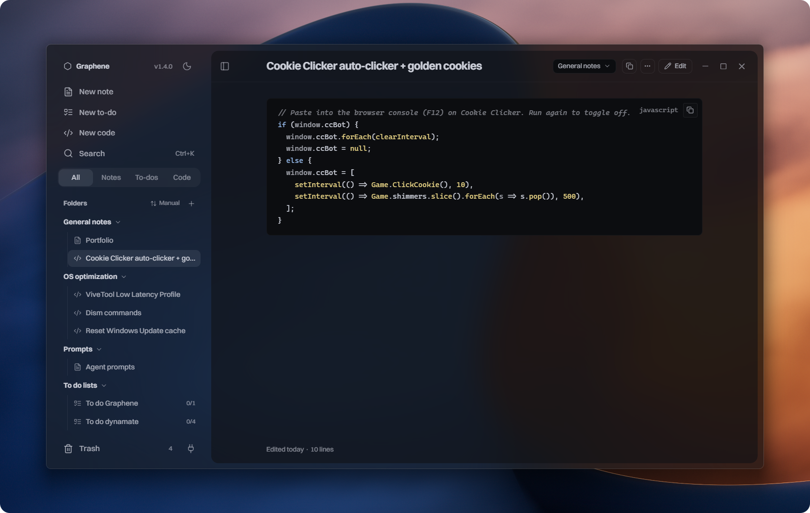

# Graphene

A minimal desktop app for writing markdown notes and keeping reusable code snippets as code blocks inside them — built with Tauri v2, React 19, and TypeScript.



## Features

### Notes
- Markdown notes with a formatting toolbar (hover a button for its shortcut), nested folders and a word count under each note. **Ctrl+E** flips between editing and reading
- **Images**: paste a picture or drop image files onto the open editor. They are copied into an `attachments` folder in your vault and linked as ``. The name `attachments` is reserved at the vault root, and that folder is not shown in the sidebar

### To-dos
- Write tasks as `- [ ] item` and click a checkbox in the reading view to tick it. **Enter** on a task line starts the next task
- A note that starts with a task is a **to-do**: it gets its own icon and filter, shows progress (`2/5`) and can hide finished tasks. **Ctrl+Alt+N** starts one
- Drag a task's handle to reorder tasks. Add `due:2026-12-01` to a task for a due-date chip (red when overdue, blue on the day)

### Code
- **Ctrl+Shift+N** starts a note with an empty code block; the word after the opening fence is the language (**Ctrl+L** changes it)
- Syntax highlighting (JS, TS, CSS, SCSS, HTML, shell, JSON, Python, SQL and more) and a copy button. **Ctrl+C** with nothing selected copies the code when the note has exactly one block
- A note that starts with a code block counts as code in the sidebar

### Organization and search
- Drag notes and folders to move or reorder them, or onto Trash to delete. Order by hand, name or recent; filter by All / Notes / To-dos / Code
- Search palette (**Ctrl+K**) with `in:folder`, `type:todo` (or `note`, `code`), `title:word`, `"an exact phrase"` and `-word`. **Ctrl+F** finds in the open note
- Right-click works everywhere (**Shift+F10** opens the menu of the selected item). Rename with **F2**

### Trash
- Deleted notes move to a hidden `.trash` folder in the vault, with an Undo bar for a few seconds. Restore or empty the trash from the button at the bottom of the sidebar
- Emptying also deletes pictures in `attachments` that no note mentions any more, but only ones Graphene saved itself

### Import
- Drop `.md` files onto the window to import them into the selected folder, or `.js`, `.ts`, `.css`, `.scss`, `.html` and `.sh` files to import them as code notes

### Editing, window and updates
- Autosave about a second after you stop typing and before you leave the editor; **Ctrl+S** saves now, **Ctrl+Enter** saves and goes back to reading
- Light, dark or system theme (button at the top of the sidebar). The sidebar hides with the button in the top-left corner and starts hidden in a window narrower than 800px. The window remembers its size and position, and a second launch brings the open one forward
- Updates (Windows): Graphene checks a few seconds after launch. The **Update** pill shows the changes of every version you are missing, with an **Install and restart** button; click the version number to check again

### Keyboard shortcuts

| Shortcut | Action |
|---|---|
| Ctrl+N / Ctrl+Shift+N / Ctrl+Alt+N | New note / code / to-do |
| Ctrl+K | Search palette |
| Ctrl+F | Find in the open note (Enter next, Shift+Enter previous) |
| Up / Down | Move through the sidebar list or the search results |
| Ctrl+E | Edit / back to reading |
| Ctrl+S | Save now |
| Ctrl+Enter | Save and go back to reading |
| Escape | Close the editor |
| Ctrl+Z / Ctrl+Shift+Z (or Ctrl+Y) | Undo / redo in the editor |
| Ctrl+B / Ctrl+I | Bold / italic |
| Ctrl+L | Set the language of the code block at the cursor |
| Ctrl+C | Copy the code of the open note (nothing selected, one code block) |
| F2 | Rename the open item |
| Shift+F10 | Context menu of the selected item |
| Del | Move the item to the trash, or delete the selected folder (asks first) |

### Storage
- A vault is a folder you choose. Every note is a `.md` file with YAML frontmatter, and folders are real folders
- Edit notes elsewhere (another editor, Dropbox, Syncthing, git) and Graphene picks the change up when you switch back to its window. A note you are typing in keeps your text. Windows line endings load fine
- Only `.md` files with an `id` in their frontmatter are notes; anything else in the vault is left alone (snippet files from v0.1.0 are not converted)
- The vault location is stored in `%APPDATA%\com.graphene.app\graphene\config.json`. No cloud, no accounts

### Use your notes from AI assistants (MCP)
A small [MCP](https://modelcontextprotocol.io) server lets assistants such as Claude search, read, add to and edit your notes. It reads the vault folder directly, so it works with Graphene closed, and it follows the app's rules (note kinds, search language, tasks and `due:` dates).

Click the plug button at the bottom of the sidebar to connect one:
- **Claude app:** "Add to Claude" installs the bundled extension (`graphene.mcpb`, also attached to every [release](https://github.com/MogensenJesse/graphene/releases/latest)). No Node.js needed. The Claude app does not update it, so add it again after updating Graphene
- **Claude Code, Cursor, ChatGPT desktop and Codex, VS Code (Copilot), Gemini CLI:** the dialog shows the command or JSON for each. They need Node.js 18 or newer
- ChatGPT and Claude in a web browser cannot reach programs on your computer

What an assistant may do with your notes is set in its own permissions.

| Tool | What it does |
|---|---|
| `list_folders` | The folders, with how many notes each holds |
| `search_notes` | Find notes with the app's search language; an empty query lists the newest |
| `read_note` | The whole text of a note |
| `list_tasks` | Tasks across all notes, soonest due first; filter by `due_by`, `folder`, `include_done` |
| `create_note` | A new note, optionally in a folder (created if missing) |
| `append_to_note` | Add text to the end of a note, for example `- [ ] text due:2026-12-01` |
| `edit_note` | Replace `old_text` with `new_text` in a note; it must match exactly and appear once, unless `replace_all` is set |
| `set_task_done` | Tick or untick a task by its line number from `list_tasks` |

- It never deletes, renames or moves a note. The four tools that only read are marked read-only, so assistants can treat them differently from the ones that write
- It uses the vault Graphene has chosen; `--vault <folder>` (or `GRAPHENE_VAULT`) points it at another one
- If a note is open in Graphene with unsaved typing, Graphene's next autosave wins over what an assistant wrote there
- The text of your notes is handed to the assistant, so only connect ones you trust

To set it up from the source instead (here for Claude Code):

```bash
npm run build:mcp
claude mcp add --scope user graphene -- node <path to dist-mcp/graphene-mcp.mjs>
```

`npm run pack:mcpb` builds the Claude extension, `dist-mcp/graphene.mcpb`.

## Stack

- [Tauri v2](https://tauri.app) — desktop shell (transparent acrylic window, no decorations)
- React 19 + TypeScript — UI
- Vite — build tooling
- SCSS + CSS custom properties — styling
- [Lucide](https://lucide.dev) icons (ISC license), copied as inline SVG in `src/components/ui/Icon.tsx`
- [Biome](https://biomejs.dev) — linting and formatting
- [MCP TypeScript SDK](https://github.com/modelcontextprotocol/typescript-sdk) — the notes server (`mcp/`)

## Development

```bash
npm install
npm run tauri dev
npm test
```

`tauri dev` and `tauri build` first build the MCP server and the Claude extension, because the app ships them.

## Build

```bash
npm run tauri build
```

Builds sign the updater files, so set `TAURI_SIGNING_PRIVATE_KEY` (the key file's path or contents) and `TAURI_SIGNING_PRIVATE_KEY_PASSWORD` first; without them the build fails at the end. `tauri dev` needs neither.

## Releases

A GitHub Action builds the Windows installer when a version tag is pushed, adds `graphene.mcpb` to the draft release, and installed copies update themselves from it.

1. While you work, add short lines under `## Unreleased` in `CHANGELOG.md`, grouped as `### New`, `### Changed`, `### Fixes` and `### Other`. The same text becomes the GitHub release notes and the changelog inside the app.
2. `npm version patch` (or `minor` / `major` / an exact number). It checks the changelog, bumps `package.json` and `src-tauri`, turns `## Unreleased` into `## vX.Y.Z`, commits "Release vX.Y.Z" and tags it. The working tree must be clean.
3. `git push --follow-tags`
4. Review the draft release on GitHub and publish it. Installed apps only see published releases.

One-time setup: generate a signing key with `npx tauri signer generate -w %USERPROFILE%\.tauri\graphene.key`, put the public key in `src-tauri/tauri.conf.json` (`plugins.updater.pubkey`), and add the repository secrets `TAURI_SIGNING_PRIVATE_KEY` (the key file's contents) and `TAURI_SIGNING_PRIVATE_KEY_PASSWORD`. Keep the private key safe: without it, installed copies can no longer update. Copies from before v0.2.0 have to be reinstalled by hand once.
